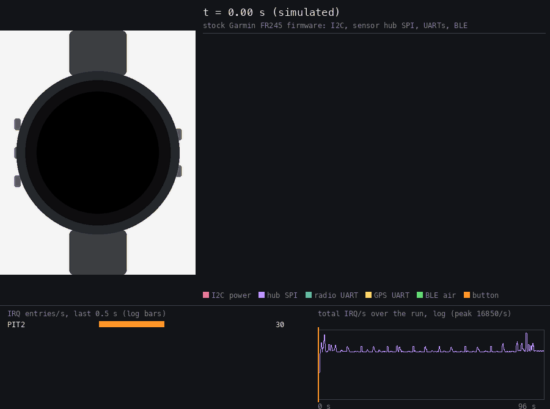

## Run Garmin Forerunner 245 firmware in a simulator



Stock Garmin firmware, unmodified; right panel = the firmware's real UART traffic and the BLE packets it caused, same simulated clock.
From t = 0: the display is dark for the first 55 s while the firmware sets up the MAX17048 fuel gauge and MAX20303 PMIC over I2C (writes only; it never reads VCELL or SOC), then formats the 32 MiB QuadSPI NOR (erase and program, one line per 4 s of simulated time) and probes the sensor hub (PTA27 reset). The display first draws at 55.4 s. Left: the display pixels the firmware clocks out (language screen, English, Pair with phone, Yes, then the advertising burst); the pressed button lights. Dead time is skipped; the clock shows the real simulated time. `./run.sh` regenerates it (`scripts/demo_gif.py`).

```sh
./run.sh    # downloads Garmin's v3.10 firmware, runs 80 virtual s (about 90 s wall), writes PNG frames to out/frames/
```


Garmin's unmodified Forerunner 245 v3.10 firmware (NXP Kinetis K28, MK28FN2M0VMI15) running on pyrite, the Simantic
simulator. The display is rendered from the pixels the firmware clocks out of FlexIO; each frame is a PNG.

**Timeline of the scenario** (virtual time; buttons are active-low, pressed for 300 ms):

| Time | Event | Screen |
| --- | --- | --- |
| 4.82 s | boot | [Garmin logo](docs/screens/1-boot-logo-4.8s.png) |
| 12.9 s | | [language screen, "English"](docs/screens/2-language-12.9s.png) |
| 16.0 s | PTC11 | no visible change |
| 17.8 s | PTD10 | [list scrolls down](docs/screens/3-scrolled-after-PTD10.png) |
| 19.6 s | PTD1 | [scrolls back](docs/screens/4-back-after-PTD1.png) |
| 21.4 s | PTA20 | [screen redraws](docs/screens/5-redraw-after-PTA20.png) |
| 23.2 s | PTA22 | no visible change |


All parts around the MCU are Python peers in `peers/`, wired in `sim/overlay.board`; the scenario is `sim/scenario.yaml`.

**Needs** Python 3 and a pyrite `sim` build that includes the `MK28FN2M0VMI15` chip. That chip is not in a release yet, so
point `SIM=/path/to/sim ./run.sh` at a build that has it.

**The firmware is not in this repo.** `scripts/garmin_fr245_image.py` downloads
`https://download.garmin.com/software/Forerunner245_310.gcd` from Garmin, checks its sha256
(`ffc802fd505cb62fe680dd50935654ef8177c8a0c74d20de3a6b32a4d185ff43`), unpacks the application stream and writes `out/fr245.elf`
(internal flash at 0x3000, QuadSPI code alias at 0x04617000, entry 0x31F1). `out/` is git-ignored.

Peer tests: `python3 -m pytest peers`.

## Reaching "Pair with phone?"

With the QuadSPI NOR backed by the array (pyrite branch `agent/fr245-boot-3744`), the firmware formats its 32 MiB
flash filesystem on first boot (about 63 s of virtual time, erase times from the shared NOR model), then the language
screen answers PTD10 at 75 s: [English selected](docs/screens/6-english-selected-75s.png), then
[Pair with phone? Yes / No](docs/screens/7-pair-with-phone-75s.png). The scenario runs 80 s virtual (about 90 s wall).
On the pair screen PTD10 selects the highlighted entry (a second press at 80 s moves to an "Initializing" screen, [frame](docs/screens/8-initializing-after-yes-95s.png)); PTA20 moves the highlight Yes to No.

## Bluetooth (advertising goes over the simulated air)

The radio is a CYW20719 on LPUART0 (reset PTA26). With `cyw20719_wiced.py` the firmware (v3.10) completes BLE init: register
app, 0x42, nine 0x37 add-service, 0x16 name "Forerunner 245", 0x12, 0x14, 0x08, then the GATT table build from the 14-entry
table in the image (0x29 add service, 0x2b add characteristic). Replies need a non-zero u16 handle at event bytes [9..10], or
the table builder sends nothing more. After that the BLE manager idles waiting for a connection (its 1 Hz routine sees
connection handle 0xffff).

The firmware sends no "set advertising data" or "enable advertising" command. Advertising is one 400-byte configuration
command (opcode byte 0x08, built at flat address 0x2233c0; mode 0 = off, mode 1 = on) that the radio turns into advertising.
Mode 1 carries flags 0x06, a 16-bit service list with 0xFE1F (Garmin) and manufacturer data (company 0x0087, then
07 00 0c 04 01 and a 4-byte unit id, ff ff ff ff here); the name comes from the earlier 0x16 command. Mode 1 is sent at
60.5 s and 80.0 s, mode 0 at 63.5 s (cause not yet found).

### Over the air to a simulated phone

`scripts/ble_phone.py out/ble.pcap` is the phone. The scenario's BLE medium joins the radio (`dut.cyw`) to a second
endpoint (`dut.phone`, a listening radio) and writes every advertisement to `out/ble.pcap` (BLE LL with PHDR, opens in
Wireshark); the script decodes it:

```
[  59.9068s] ch37 ADV_IND  00:00:00:00:00:00  flags=0x06  uuids=0xFE1F  company=0x0087 mfg=0c0401ffffffff  name="Forerunner" (shortened)
   ... until 63.4887s: 168 advertisements
[  80.0295s] ch37 ADV_IND  00:00:00:00:00:00  flags=0x06  uuids=0xFE1F  company=0x0087 mfg=0c0401ffffffff  name="Forerunner" (shortened)
   ... until 89.9734s: 462 advertisements
```

Nothing is on the air from 63.51 s (mode 0) to 80.03 s. The watch screen at those moments: boot logo while advertising
([59.9 s](docs/screens/9-adv-on-59.9s.png)), still the logo at [mode 0, 63.5 s](docs/screens/10-adv-off-63.5s.png), and
[80.0 s](docs/screens/11-adv-on-80.0s.png).

Real firmware: the unmodified v3.10 image builds and sends the 0x16 name and the 0x08 config. The peer decodes them
(offsets from the builder at 0x2233c0), so the on/off times (59.9 s on, 63.5 s off, 80.0 s on) are the firmware's own.
The peer now speaks when the DUT enables the LPUART0 receiver (55.406 s; the sim passes `CTRL[RE]` to the peer as
`on_rx_enable`), once: 0x1b4a then 0x24. No timer, and the firmware needed no repeat.

Stand-ins:

- The CYW20719's WICED protocol is not implemented (see the peer's header); handles, app id and the 0x24 body are guesses.
- The phone is a passive receiver plus a pcap decoder, not a scanner: it never sends SCAN_REQ, so the full name
  "Forerunner 245" (in the scan response, from the 0x16 command) is never requested. flags, the UUID list and
  manufacturer data leave 13 of the 31 AdvData bytes, so the ADV_IND carries "Forerunner" as a shortened name.
- The advertising address is all zeros (the radio's BD address is not known) and the interval is the link layer's default.
- The unit id in the manufacturer data is the firmware's ff ff ff ff.

Open: a scanning/connecting central, and whether the Initializing screen leaves.

## What is independently verified

| Claim | Source | Result |
| --- | --- | --- |
| Company ID 0x0087 = Garmin International | Bluetooth SIG `company_identifiers.yaml` | match |
| UUID 0xFE1F = Garmin International | Bluetooth SIG `member_uuids.yaml` | match |
| K28, CYW20719 and MAX20303 chips | [iFixit FR245 Music teardown](https://www.ifixit.com/Teardown/Garmin+Forerunner+245+Music+Teardown/150396) | match, Music variant |
| LPUART3 framing: DLE / id / size / data / checksum / DLE ETX, two's-complement checksum | [pygarmin physical protocol](https://pygarmin.readthedocs.io/en/stable/physical_protocol.html) | framing matches, packet meaning unknown |
| GATT UUIDs the firmware registers (below) | [Gadgetbridge Garmin protocol](https://www.gadgetbridge.org/internals/specifics/garmin-protocol) | match, see below |
| Adv byte layout, timing, GATT handles, first-boot UI | simulation only | not verified against a watch |

### Service and characteristic UUIDs, firmware vs Gadgetbridge

From one run's radio log (K28 to CYW commands 0x37 add service, 0x29 add GATT service, 0x2b add characteristic). The 0x37 commands carry the full 16 bytes (little endian). 0x29 and 0x2b carry a 16-bit id plus a base index; the base `6a4e____-667b-11e3-949a-0800200c9a66` is inferred from the 0x37 entry `6a4e3e10-...`, which uses the same base, so for those the 16-bit id is what was compared.

| UUID registered by the firmware | Gadgetbridge list | Result |
| --- | --- | --- |
| 6a4e2800-667b-11e3-949a-0800200c9a66 (service) | 6a4e2800 | match |
| 6a4e8022-667b-11e3-949a-0800200c9a66 (service) | 6a4e8022 | match |
| chars 6a4e2803, 2810, 2820, 2811, 2821, 2812, 2822 (all under service 2800) | same seven | match (7 of 7) |
| chars 6a4e4c80, 6a4ecd28 | same two | match |
| service 6a4e2500 with chars 2501, 2502, 2503, 2505 | not listed | in firmware only |
| 6a4e3e10-667b-11e3-949a-0800200c9a66 (0x37) | not listed | in firmware only |
| eight 0x37 UUIDs on other bases: 7905f431-b5ce-4e99-a40f-4b1e122d00d0, 9fbf120d-6301-42d9-8c58-25e699a21dbd, 69d1d8f3-45e1-49a8-9821-9bbdfdaad9d9, 22eac6e9-24d6-4bb5-be44-b36ace7c7bfb, 89d3502b-0f36-433a-8ef4-c502ad55f8dc, 9b3c81d8-57b1-4a8a-b8df-0e56f7ca51c2, 2f7cabce-808d-411f-9a0c-bb92ba96c102, c6b2f38c-23ab-46d8-a6ab-a3a870bbd5d7 | not Garmin's; these look like Apple's ANCS and AMS service and characteristic UUIDs (recalled from Apple's public documentation, not re-checked here) | not in Gadgetbridge's Garmin list, unverified |

No mismatches: every UUID on Gadgetbridge's list is registered by the firmware.

### How to check on a real watch

Put a Forerunner 245 (Music) in pairing mode and scan with nRF Connect. The advertisement should show flags 0x06, the 16-bit service 0xFE1F, manufacturer data with company 0x0087 and a name starting "Forerunner". Compare each field with the first packets in `docs/ble.pcap` (open it in Wireshark, or `python3 scripts/ble_phone.py docs/ble.pcap`). Fields that differ (address, interval, unit id, shortened name) are simulation stand-ins listed under Stand-ins above.

## Known gaps

- The host-link reply on LPUART3 is unknown, so `garmin_link_peer.py` only logs. The firmware retries about 3 times before
  the UI appears.
- PTC11 and PTA22 change nothing visible on the language screen.
- The QuadSPI base address was fitted from pointers in the image, not read from documentation.
- The display peer's pixel framing and line packing were derived from observed waveforms and the firmware's packer, not
  from a panel datasheet; the panel is unidentified.
- Fuel gauge, PMIC and sensor hub peers are scripted register models; timing is not measured against a watch.
- No GPS or heart-rate models; the radio is the stand-in above. The flash filesystem is the shared NOR model with an erased (0xFF) array; its size (32 MiB) and timing are not the FR245 part's.
