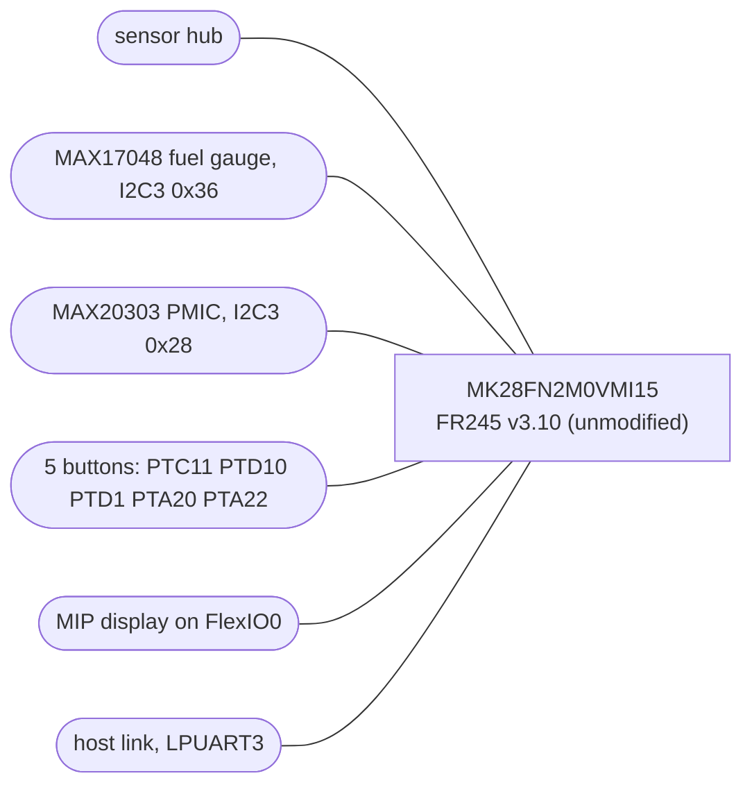

<!-- simantic-banner -->
> **Run this firmware with no hardware.** [Simantic](https://simantic.com) simulates the whole board, peripherals, sensors and buses included. Try it free at **[simantic.com](https://simantic.com)**, or run it locally: `curl -fsSL https://simantic.com/install | sh`

## Run Garmin Forerunner 245 firmware in a simulator


HD versions of the same run (1080p, 30 fps, same simulated-clock timing as the GIF): [demo.mp4](docs/screens/demo.mp4) (1920x1080) and [demo_vertical.mp4](docs/screens/demo_vertical.mp4) (1080x1920).

Stock Garmin firmware, unmodified, booted from a formatted ("factory") flash. Left: the watch, with the 240x240 display pixels the firmware clocks out (nearest-neighbour, each pixel a block) and the pressed button lit. Right: the firmware's real traffic on the same simulated clock: I2C writes to the MAX17048 fuel gauge and MAX20303 PMIC, sensor hub SPI messages, the radio UART, the GPS UART handshake, BLE adverts on the simulated air (one row per second) and the button presses. Under it, an IRQ panel (top 8 interrupts of the last 0.5 s, log bars, plus total IRQ/s over the run), aggregated live from `--trace-interrupts` by `scripts/irq_bins.py` into 100 ms bins (`out/irq_rates.json`, git-ignored; the ~1 GB raw trace is never written; `IRQ=0 ./run.sh` drops the panel). Dead time is skipped; the clock shows the real simulated time. GPS is parked (see below). A person's pace is scripted in `sim/overlay.board` (`btn`: one press every 2.5 s). `./run.sh` regenerates the GIF and both MP4s (`scripts/demo_gif.py`, needs ffmpeg for the MP4s). The watch drawing (`scripts/watch_render.py`, Pillow only) is a generic round sports watch with the FR245's button layout; it uses no manufacturer artwork.


Garmin's unmodified Forerunner 245 v3.10 firmware (NXP Kinetis K28, MK28FN2M0VMI15) running on pyrite, the Simantic simulator.

**Provenance.** Every number below comes from one `./run.sh` run (warm boot from the factory flash, 96 virtual s, 92 s wall on an Apple M5, 236 display frames), except the first-boot column, which is one separate `./run.sh --first-boot` run, and two short bounded probes (`--trace-memory` on RTC and SIM_CLKDIV1, 2 to 4 virtual s).

| | |
| --- | --- |
| pyrite | commit `5f59b385874894cb237ff0fc13b0569dd0f3a9c3` (`sim` built with the MK28FN2M0VMI15 chip) |
| Garmin download | `Forerunner245_310.gcd`, sha256 `ffc802fd505cb62fe680dd50935654ef8177c8a0c74d20de3a6b32a4d185ff43` |
| Unpacked application ELF (`out/fr245.elf`) | sha256 `a07197a58f1796e2d99e631ed9091b2cdee72ffb0d039bf34f2db9657af205a2` (what `scripts/garmin_fr245_image.py` writes; re-checked) |
| Clock | core 120 MHz, bus 60 MHz (see Clock) |

```sh
./run.sh    # downloads Garmin's v3.10 firmware, runs 96 virtual s (about 92 s wall), writes PNG frames to out/frames/, the GIF and the MP4s
```

**Timeline** (virtual time, warm boot from the factory flash). Buttons are active-low, held 300 ms, one press every 2.5 s. "Shown" is the first frame identical to the PNG. Button names are inferred from behaviour (see Buttons).

| Shown (s) | Screen | Last press before it | Image |
| --- | --- | --- | --- |
| 2.75 | Garmin logo | | [png](docs/screens/01-boot-logo-3s.png) |
| 5.92 | language screen (first screen that takes buttons) | | [png](docs/screens/02-language-6s.png) |
| 7.91 | Pair with phone? Yes / No | START at 7.5 | [png](docs/screens/03-pair-with-phone-10s.png) |
| 10.71 | Download Garmin Connect Mobile | START at 10.0 | [png](docs/screens/04-download-garmin-connect-mobile-12s.png) |
| 13.30 | Pair with phone? again | BACK at 13.0 | [png](docs/screens/05-pair-with-phone-back-14s.png) |
| 16.11 | No highlighted | DOWN at 16.0 | [png](docs/screens/06-pair-no-highlighted-17s.png) |
| 18.91 | Distance: Miles | START at 18.5 | [png](docs/screens/07-distance-units-20s.png) |
| 21.42 | Time Format | START at 21.0 | [png](docs/screens/08-time-format-23s.png) |
| 23.91 | Gender | START at 23.5 | [png](docs/screens/09-gender-26s.png) |
| 28.56 | Birth Year | START at 28.5 | [png](docs/screens/10-birth-year-30s.png) |
| 36.05 | Height | START at 36.0 | [png](docs/screens/11-height-37s.png) |
| 41.41 | Weight | START at 41.0 | [png](docs/screens/12-weight-42s.png) |
| 48.88 | Set Time: Use GPS / Manual | START at 48.5 | [png](docs/screens/13-set-time-use-gps-50s.png) |
| 51.08 | Manual highlighted | DOWN at 51.0 | [png](docs/screens/14-set-time-manual-53s.png) |
| 53.91 | Set Hours | START at 53.5 | [png](docs/screens/15-set-hours-55s.png) |
| 56.06 | Set Minutes | START at 56.0 | [png](docs/screens/16-set-minutes-58s.png) |
| 66.06 | Set Year | START at 66.0 | [png](docs/screens/17-set-year-67s.png) |
| 71.41 | Set Month | START at 71.0 | [png](docs/screens/18-set-month-73s.png) |
| 73.91 | Set Day | START at 73.5 | [png](docs/screens/19-set-day-75s.png) |
| 79.58 | watch face (clock, 0.0 mi) | START at 78.5 | [png](docs/screens/20-watch-face-80s.png) |
| 85.95 | Run glance (GPS red: no fix, parked) | START at 84.5 | [png](docs/screens/21-run-glance-86s.png) |

AM/PM is a step between Set Minutes and Set Year. After the run glance: BACK at 87.0 returns to the watch face, START at 89.5 opens it again, PTA22 at 92.0 shows the tip bubble "Hold for activity settings, training, and more." The numeric fields (birth year 1978, height 5'10", weight 170, time 1:00 AM, 1 Jan 2019) are the firmware's defaults, accepted with START.

**Buttons.** Names are inferred from what the firmware does, not from a wiring document: PTD10 selects and opens the run glance from the watch face = START (top right); PTA20 moves the highlight down = DOWN (bottom left); PTD1 goes back and does nothing on the watch face = BACK (bottom right). PTA22 (UP, middle left) and PTC11 (LIGHT, top left) are the two left over and are guesses: PTA22 shows the tip bubble, PTC11 changes nothing visible. The first version of this repo labelled PTD10 as DOWN and PTA20 as START; the firmware's behaviour contradicts that.

**Boot against a real watch**

| | Real watch ([video](https://www.youtube.com/shorts/SEK3FTuwlyA), read off by hand) | Sim, warm boot (factory flash) | Sim, `--first-boot` |
| --- | --- | --- | --- |
| Logo | about instant | 2.75 s | 54.02 s |
| First screen that takes buttons | about 15 s (watch face) | 5.92 s (language screen) | 57.15 s (language screen) |
| Watch face | about 15 s | 79.58 s, after the scripted wizard (presses 7.5 to 78.5 s) | not run that far |

The comparable number is the language screen at 5.92 s; the sim's watch face time includes the scripted wizard.

Why the logo is not instant. About 1 s of the 2.75 s is the firmware waiting for the 32.768 kHz RTC oscillator: RTC_CR is written 0x500 (oscillator enabled, 16 pF load) at 0.0272 s (pc 0xC43E0) and the next RTC access is at 1.0272 s (pc 0xC43F2); the first MAX17048 write follows at 1.1276 s. A cold crystal needs time to start (not checked against the reference manual); the sim keeps the wait because the firmware requests it. The rest is the firmware's own init up to the first draw.

Why first boot is 54 s. With no filesystem the firmware formats the 32 MiB QuadSPI NOR: 336 block erases and 1476 page programs over 54 one-second log lines (1 s to 54 s), then draws the logo. That time is set by the shared NOR model's generic erase and program timings, not by the FR245's part; datasheet-class timings would make it longer (about 94 to 128 s, an estimate for a part we have not identified). `scripts/make_factory_flash.sh` runs the format once and dumps the array to `out/factory_nor.bin`, which the default run preloads. The button script is timed for the warm boot, so on a first boot its first presses land while the flash is still being formatted.

**Clock.** SIM_CLKDIV1 is written 0x01140000 at 0.0270 s (pc 0xBEA1E): OUTDIV1 = /1, OUTDIV2 = /2, OUTDIV4 = /5. The model takes the core clock as MCGOUTCLK / OUTDIV1 and the bus clock as core / OUTDIV2 (PIT counts the bus clock), with MCGOUTCLK computed from the firmware's MCG writes: 120 MHz core, 60 MHz bus, 24 MHz flash clock. MCGOUTCLK = 120 MHz is the model's result; we did not measure it separately.

**Accelerometer batches.** The sensor hub accepts the K28 at 2.23 s; the K28 configures the accelerometer at 3.15 s (25 Hz, batch 1000 ms, 8 g); 81 batches of 25 samples follow from 4.15 s to 84.29 s, one per second. At 84.59 s, right after START opens the run glance, the K28 reconfigures it to 25 Hz with a 120 ms batch, and 56 batches of 3 samples follow from 84.80 s to 95.86 s (25 Hz x 0.120 s = 3). The 3-sample batches are real firmware behaviour, and they start at the run glance, not at the watch face. Their spacing is 0.201 s on average, not 0.120 s: the peer queues a batch every 120 ms but the transfer waits for the hub's SRDY offers (a guessed 100 ms idle period), so this cadence is a stand-in artefact. We did not check whether samples are lost. The sample values are a stand-in (flat wrist, +1 g on Z, small noise).

**IRQ rates** (exception entries per second, mean over each window of this run; names from the chip's NVIC wiring):

| IRQ | boot 0.5 to 2.7 s | wizard 10 to 70 s | watch face 80 to 84 s | run glance 86 to 95 s |
| --- | --- | --- | --- | --- |
| LPTMR0 (OS tick) | 731 | 1020 | 1020 | 1021 |
| PendSV | 205 | 129 | 40 | 199 |
| PIT2 | 320 | 17 | 8 | 614 |
| QuadSPI0 | 326 | 5 | 0 | 614 |
| I2C3 (power) | 126 | 4 | 6 | 8 |
| PORTB | 38 | 4 | 3 | 22 |
| LPUART3 (GPS) | 0 | 35 | 0 | 32 |
| LPUART0 (radio) | 0 | 1 | 0 | 12 |
| FlexIO0 (display) | 0 | 4 | 2 | 10 |
| total | 1755 | 1224 | 1081 | 2550 |

LPTMR0 is the 1 kHz OS tick (1020 to 1022/s once running; 1024/s would be a 32.768 kHz clock divided by 32, not checked). QuadSPI0 and PIT2 are unexplained: their counts are near-equal and they come in bursts (about 2.8k in second 2, 316 at 78 s and 84 s, 3947 in second 88 to 89) at screen changes, not as a steady rate; the 614/s in the run glance column is one burst averaged over the window. LPUART3 and LPUART0 are the GPS 11 s reset loop and the radio handshakes. The total peaks at 16850/s at boot.



All parts around the MCU are Python peers in `peers/`, wired in `sim/overlay.board`; the scenario is `sim/scenario.yaml`.

**Needs** Python 3 and a pyrite `sim` build that includes the `MK28FN2M0VMI15` chip. That chip is not in a release yet, so
point `SIM=/path/to/sim ./run.sh` at a build that has it.

**The firmware is not in this repo.** `scripts/garmin_fr245_image.py` downloads
`https://download.garmin.com/software/Forerunner245_310.gcd` from Garmin, checks its sha256
(`ffc802fd505cb62fe680dd50935654ef8177c8a0c74d20de3a6b32a4d185ff43`), unpacks the application stream and writes `out/fr245.elf`
(internal flash at 0x3000, QuadSPI code alias at 0x04617000, entry 0x31F1). `out/` is git-ignored.

Peer tests: `python3 -m pytest peers`.

## Setup wizard and the sensor hub

The wizard runs end to end on the stock firmware: language, Pair with phone (Yes shows "Download Garmin Connect Mobile", then "Go to mobile app to add device" after about 8 s; PTD1 goes back), units, time format, gender, birth year, height, weight, Set Time. On Set Time, Manual gives Set Hours, Minutes, AM/PM, Year, Month, Day and then the watch face. Use GPS would wait for a fix forever (GPS is parked).

The sensor hub (`peers/spi/garmin_sensor_hub_spi.py`) is accepted at 2.23 s (the K28's hello, answered with hub id 0x0100 and a version string). Accelerometer configuration and batch timing are under Accelerometer batches above.

## Bluetooth (advertising goes over the simulated air)

The radio is a CYW20719 on LPUART0 (reset PTA26). With `cyw20719_wiced.py` the firmware (v3.10) completes BLE init: register
app, 0x42, nine 0x37 add-service, 0x16 name "Forerunner 245", 0x12, 0x14, 0x08, then the GATT table build from the 14-entry
table in the image (0x29 add service, 0x2b add characteristic). Replies need a non-zero u16 handle at event bytes [9..10], or
the table builder sends nothing more. After that the BLE manager idles waiting for a connection (its 1 Hz routine sees
connection handle 0xffff).

The firmware sends no "set advertising data" or "enable advertising" command. Advertising is one 400-byte configuration
command (opcode byte 0x08, built at flat address 0x2233c0; mode 0 = off, mode 1 = on) that the radio turns into advertising.
Mode 1 carries flags 0x06, a 16-bit service list with 0xFE1F (Garmin) and manufacturer data (company 0x0087, then
07 00 0c 04 01 and a 4-byte unit id, ff ff ff ff here); the name comes from the earlier 0x16 command. In this run the name (0x16) is sent at 5.46 s,
mode 0 at 5.76 s and mode 1 at 7.53 s, and no mode 0 follows.

### Over the air to a simulated phone

`scripts/ble_phone.py out/ble.pcap` is the phone. The scenario's BLE medium joins the radio (`dut.cyw`) to a second
endpoint (`dut.phone`, a listening radio) and writes every advertisement to `out/ble.pcap` (BLE LL with PHDR, opens in
Wireshark); the script decodes it:

```
[   7.5255s] ch37 ADV_IND  00:00:00:00:00:00  flags=0x06  uuids=0xFE1F  company=0x0087 mfg=0c0401ffffffff  name="Forerunner" (shortened)
   ... until 95.9459s: 4083 advertisements
```

Advertising runs from 7.5255 s to 95.9459 s (the end of the run): one advertising event about every 65 ms, 1361 events of three packets (ch37, 38, 39: 1361 each), 4083 in all. It continues through the Pair with phone, Download Garmin Connect Mobile and Go to mobile app screens and the rest of the wizard (the watch never connects).

Real firmware: the unmodified v3.10 image builds and sends the 0x16 name and the 0x08 config. The peer decodes them
(offsets from the builder at 0x2233c0), so the on/off times (off 5.76 s, on 7.53 s) are the firmware's own.
The peer now speaks when the DUT enables the LPUART0 receiver (about 3.06 s; the sim passes `CTRL[RE]` to the peer as
`on_rx_enable`), once: 0x1b4a then 0x24. No timer, and the firmware needed no repeat.

Stand-ins:

- The CYW20719's WICED protocol is not implemented (see the peer's header); handles, app id and the 0x24 body are guesses.
- The phone is a passive receiver plus a pcap decoder, not a scanner: it never sends SCAN_REQ, so the full name
  "Forerunner 245" (in the scan response, from the 0x16 command) is never requested. flags, the UUID list and
  manufacturer data leave 13 of the 31 AdvData bytes, so the ADV_IND carries "Forerunner" as a shortened name.
- The advertising address is all zeros (the radio's BD address is not known) and the interval is the link layer's default.
- The unit id in the manufacturer data is the firmware's ff ff ff ff.

Open: a scanning/connecting central, and whether the Initializing screen leaves.

## What is independently verified

| Claim | Source | Result |
| --- | --- | --- |
| Company ID 0x0087 = Garmin International | Bluetooth SIG `company_identifiers.yaml` | match |
| UUID 0xFE1F = Garmin International | Bluetooth SIG `member_uuids.yaml` | match |
| K28, CYW20719 and MAX20303 chips | [iFixit FR245 Music teardown](https://www.ifixit.com/Teardown/Garmin+Forerunner+245+Music+Teardown/150396) | match, Music variant |
| LPUART3 framing: DLE / id / size / data / checksum / DLE ETX, two's-complement checksum | [pygarmin physical protocol](https://pygarmin.readthedocs.io/en/stable/physical_protocol.html) | framing matches, packet meaning unknown |
| GATT UUIDs the firmware registers (below) | [Gadgetbridge Garmin protocol](https://www.gadgetbridge.org/internals/specifics/garmin-protocol) | match, see below |
| Adv byte layout, timing, GATT handles, first-boot UI | simulation only | not verified against a watch |

### Scripted phone connection (design note)

`CYW_PHONE_CONNECT_S=12 ./run.sh` makes the radio peer send, at that virtual time, a connected event, a CCCD enable on
6a4e2810 and a multi-link register request. Formats below are read off the BLE manager (v3.10) by static analysis; every
meaning marked (inferred) is a MODELED SIMPLIFICATION. Radio to K28 events travel as opcode 0x1984 (0x1985, 0x1986) with a
message whose byte 0 is the type; 0x30f00 hands it to every callback registered through 0x30e7c, the BLE host's being 0x226588.
Responses to host commands travel as opcode 0x1983 (callback 0x2261ac).

| Type | Handler | Layout | Effect |
| --- | --- | --- | --- |
| 0x24 | 0x226588 | empty | stack up (already sent) |
| 1 | 0x226588 case 1, 0x226684, 0x227a38 | [1..2] handle, [3..4]=16, [13..19] peer address (order inferred), [20]==1 connected | stores the handle at 0x1ffe7a4c (idles 0xffff), copies the address, posts UI message 0x15, the firmware then sends host commands 0x0f, 0x0a, 0x2e |
| 2 | 0x226588 case 2 | [1..2] handle, [5] reason | clears the handle to 0xffff, posts message 0x16 |
| 3 | 0x2230a8, 0x223f44 | [1..2] handle, [5..12] 8 bytes (connection parameters, inferred) | posts message 0x20 |
| 0xd | 0x2230a8 | [1..2] handle, [5] value | posts message 0x11 (link status, inferred) |
| 0x1d | 0x31570 fix-up, 0x2287c4, 0x227a38, 0x225318 | [1..2] handle, [3..4]=16, [9..10] attribute handle, [13..14] length, [17..20] pointer slot, data at [21..] | GATT write: CCCD (length 2) or data |
| 4, 5, 6, 0xa, 0xb, 0x26 | 0x227334 | [1..2] handle | security and pairing events, layouts not decoded |
| 0xc, 0x12, 0x14, 0x15, 0x17, 0x19 to 0x1b, 0x21, 0x25 | 0x223b78, 0x223f44, 0x225318 | not decoded | |

GATT replies: 0x29 reply [9..10] service handle, [11..12] uuid16; 0x2b reply [9..10] value handle, [13..14] CCCD handle,
[17..18] uuid16, [21..22] service handle (the tables 0x227bdc and 0x228acc compare these). Replying to host commands 0x0f and
0x2e with the generic echo makes the firmware reset 0.4 ms later (fatal handler 0xd2910), so the peer stays silent for them.

Result (12.0 s, no bonding needed to get this far): the connection handle 0x1ffe7a4c goes 0xffff to 0x0040 at 12.000112 s
(pc 0x22669c). The firmware at once sends 0x0f (handle 0x40, interval 0x18-0x24, timeout 0x190), 0x0a, and 0x2e (notify on
attribute 0x36 = 6a4e2803, 4 bytes by pointer). After the register request it sends 0x2f (notify on attribute 0x39 =
6a4e2810, 13 bytes) and 0x10. The data is passed as a RAM pointer, so the peer cannot yet read the GFDI bytes. The UI did not
change (same frames as without a phone).

Next round, a phone doing Gadgetbridge's GFDI handshake needs: the air link (connection, MTU, encryption), the RAM data
behind 0x2e/0x2f (read it from the pointer or from the HCI payload), notifications on 2810 and writes on 2820 carrying ML
handles, then GFDI (device information, configuration, system event) with CRC-16, and a bond, since the firmware
may only move its UI on after pairing events (types 4 to 6, not tested).

### Service and characteristic UUIDs, firmware vs Gadgetbridge

From one run's radio log (K28 to CYW commands 0x37 add service, 0x29 add GATT service, 0x2b add characteristic). The 0x37 commands carry the full 16 bytes (little endian). 0x29 and 0x2b carry a 16-bit id plus a base index; the base `6a4e____-667b-11e3-949a-0800200c9a66` is inferred from the 0x37 entry `6a4e3e10-...`, which uses the same base, so for those the 16-bit id is what was compared.

| UUID registered by the firmware | Gadgetbridge list | Result |
| --- | --- | --- |
| 6a4e2800-667b-11e3-949a-0800200c9a66 (service) | 6a4e2800 | match |
| 6a4e8022-667b-11e3-949a-0800200c9a66 (service) | 6a4e8022 | match |
| chars 6a4e2803, 2810, 2820, 2811, 2821, 2812, 2822 (all under service 2800) | same seven | match (7 of 7) |
| chars 6a4e4c80, 6a4ecd28 | same two | match |
| service 6a4e2500 with chars 2501, 2502, 2503, 2505 | not listed | in firmware only |
| 6a4e3e10-667b-11e3-949a-0800200c9a66 (0x37) | not listed | in firmware only |
| eight 0x37 UUIDs on other bases: 7905f431-b5ce-4e99-a40f-4b1e122d00d0, 9fbf120d-6301-42d9-8c58-25e699a21dbd, 69d1d8f3-45e1-49a8-9821-9bbdfdaad9d9, 22eac6e9-24d6-4bb5-be44-b36ace7c7bfb, 89d3502b-0f36-433a-8ef4-c502ad55f8dc, 9b3c81d8-57b1-4a8a-b8df-0e56f7ca51c2, 2f7cabce-808d-411f-9a0c-bb92ba96c102, c6b2f38c-23ab-46d8-a6ab-a3a870bbd5d7 | not Garmin's; these look like Apple's ANCS and AMS service and characteristic UUIDs (recalled from Apple's public documentation, not re-checked here) | not in Gadgetbridge's Garmin list, unverified |

No mismatches: every UUID on Gadgetbridge's list is registered by the firmware.

### How to check on a real watch

Put a Forerunner 245 (Music) in pairing mode and scan with nRF Connect. The advertisement should show flags 0x06, the 16-bit service 0xFE1F, manufacturer data with company 0x0087 and a name starting "Forerunner". Compare each field with the first packets in `docs/ble.pcap` (open it in Wireshark, or `python3 scripts/ble_phone.py docs/ble.pcap`). Fields that differ (address, interval, unit id, shortened name) are simulation stand-ins listed under Stand-ins above.

## USB: the watch enumerates on a host

`./run.sh --usb` plugs the watch's USB cable in at 8 s of guest time, enumerates it as a host (`scripts/usb_host.py`, over pyrite's `--usb-raw`) and writes the transfers to `docs/usb.pcap` (Linux usbmon, opens in Wireshark; timestamps are the script's wall clock). Garmin Express talks to the watch over this USB link, not Bluetooth.

The firmware drives the K28 **USBHS** (ChipIdea/EHCI device controller at 0x400A1000, IRQ 93) with its USBPHY at 0x400A2000: its driver programs USBMODE, ENDPTLISTADDR and ENDPTSETUPSTAT, and the ISR is vector 109. The same i.MX RT ChipIdea model is reused; the K28 PHY adds `PLL_SIC` (PLL lock bit 31) at 0xA0.

What the real v3.10 firmware returns:

| | |
|---|---|
| Device | USB 2.0, class 0xff/0xff/0xff (vendor specific, not MTP), ep0 64 bytes, VID:PID **091e:0003** (Garmin), bcdDevice 0001 |
| Strings | none (iManufacturer, iProduct and iSerialNumber are 0) |
| Configuration 1 | 500 mA, one interface (0xff/0xff/0xff) with bulk IN 0x81 (512 bytes), interrupt IN 0x82 (64 bytes) and bulk OUT 0x03 (512 bytes) |
| SET_ADDRESS, SET_CONFIGURATION | accepted |

Stand-ins: the cable is a forced MAX20303 status (STATUS1 bit 3 plus INT0 bit 3 at 8 s, `usb_vbus_at_ms` in `peers/i2c/max20303.py`), found by probing which status makes the firmware call its USB init, since the PMIC datasheet and the K28 reference manual were not available. The PLL lock is instant. Not done: any Garmin protocol traffic on the bulk endpoints (it is not MTP, so GetDeviceInfo does not apply).

## Known gaps

- The host-link reply on LPUART3 is unknown, so `garmin_link_peer.py` only logs. The firmware retries about 3 times before
  the UI appears.
- PTC11 and PTA22 change nothing visible on the language screen.
- The QuadSPI base address was fitted from pointers in the image, not read from documentation.
- The display peer's pixel framing and line packing were derived from observed waveforms and the firmware's packer, not
  from a panel datasheet; the panel is unidentified.
- No heart-rate model.
- The flash filesystem is the shared NOR model (32 MiB, shared erase and program times, not the FR245 part's).

## What is real and what is a stand-in

| Part | Status |
| --- | --- |
| Garmin FR245 v3.10 firmware, K28 core, clocks (120 MHz), QuadSPI, FlexIO, LPUARTs, SPI, I2C | the real image on the pyrite model |
| Display | pixels decoded from the FlexIO waveform the firmware clocks out; the panel itself is not modelled |
| Sensor hub | stand-in Python peer: protocol read off the firmware, timings are guesses |
| Accelerometer | stand-in values (flat wrist, +1 g on Z, small noise) via the hub; the 25 Hz config and the 1 s then 120 ms batch sizes are the firmware's own; delivery cadence is a stand-in (see Accelerometer batches) |
| MAX17048 fuel gauge | stand-in; the firmware only writes it (never reads VCELL or SOC) in these runs |
| MAX20303 PMIC | stand-in register model: 4 reads at init, writes after |
| GPS (Sony CXD5603) | parked by decision: the handshake is answered, no fix is fed; the firmware's GPS start is gated on `CPE.BIN` (see GPS below) |
| BLE radio (CYW20719) | stand-in: WICED protocol not implemented; adverts are real firmware output over a simulated air, the phone is a passive receiver |
| Buttons | scripted GPIO; PTD10/PTA20/PTD1 = START/DOWN/BACK inferred from behaviour, PTA22/PTC11 = UP/LIGHT are guesses |

## GPS (LPUART3, Sony CXD5603): decoded so far

Peer: `peers/uart/sony_cxd5603_gnss.py`. Read off the firmware (RX parser 0xAC874, command queue 0xAC3D4, ACK check 0xACA58), not invented.

- Frame: `10 id len payload cksum 10 03`, DLE doubled in the body. Id 0x7b wraps `u32 data_len | u16 inner_id | data`. Inner 0xBD5 carries `u16 sub | u16 0 | u32 size | data`.
- The queue sends a message, waits 3000 ms for the ACK, resends once, then moves on (the 3.0 s spacing).
- ACK = 0xBD5 sub 8, data `u16 inst_id | u16 ack_sub | u32 data_size | u32 status`. The firmware compares inst_id with the sent id, ack_sub with 0xFFFF (0x0A and 0xBD5: first u16 of the sent data) and data_size with the sent data length. Status is only printed.
- Sent and ACKed: 0x2F `00`, 0xBBD `01000000`, 0x0A `6c00`. With these ACKs the queue stops waiting 3 s per message; the next requests follow within milliseconds (0xBD5 sub 9, 0xF9, 0x0A `ff01`).
- RX 0xBBC (u32) stores the value the 0xBBD "set" is compared against (0xAE85C, read by 0xAE6A8); 0xBBD is sent only when it differs.
- Sub 1 solved: the firmware sends the 32-byte config with bit 0 set in words 2, 3, 4 (12|1, 160|1, 4|1). 0xAE8D8 memcmps the reply with its own copy at 0x2002576c = {115200, 0x201, 12, 160, 4, 100, 0, 0x20001} (found by probing the memcmp result at 0xAE90E). The peer answers with the sent config, those flags cleared (MODELED SIMPLIFICATION: which words carry the flag). A match calls 0xAE880(1), which starts the GPS (0xAB464) and the queue advances at once.
- TX 0x30 `00080700` = baud 460800; the chip answers id 0x31 with the same u32 (0xAF87C). The firmware then sends id 0x83 (same u32) and polls 0x0A `3a00` every 0.7 s; an ACK of that with status 1 reaches 0xAF87C(0x3A) (0xACB52-0xACB9A) and ends the poll. The peer does both.
- 0x2F `xx` is the firmware's own GPS-task state (0 init, 10 and 2 = reset, 20 = running; 0xAE6F4, handler 0xAB74-0xAC42). After the 0x3A ack the firmware requests state 10 and resets 0.22 s later, then repeats the init every 11 s; it never reaches state 20, so no GPS-state-machine TX (BD5 sub 0x17, 0x1E, 0x14, 0x1D; 0xAAC3C) is sent. Cause not found yet.
- RX BD5 subs 19 and 26 (0xAD014) are a 32-byte header plus 84-byte chunks (36 u16 each) into a 1024-u16 buffer, probably assistance data; 0x7D/0x7E are a chunked transport (0xABEAC); neither is the position stream.
- Setup wizard (START = PTD10 selects, DOWN = PTA20 moves the highlight): language, Pair with phone, units, time format, gender, birth year, height, weight, then "Set Time: Use GPS / Manual". Use GPS shows "Wait for GPS" (a red arc) and the hint "GPS signal is stronger outside"; it waits for a fix. Nothing is fed yet, so it waits forever. Firmware strings name the inputs: "Send initial position to Sony: lat, lon", "inject_time: date, time", "inject_phone_position", Sony CEP files (0xAEE8C-0xAEFFC, 0xAB544).
- Product data: plain frame id 0xFF (Garmin Pid_Product_Data), `u16 product_id | u16 sw_version | NUL-terminated name`, reaches 0xAA564 through the HAL queue (0xA5748 -> 0xA6B94 -> 0xA687C) and stores sw_version x 100 at 0x200253b8. The peer sends it on every 0xF9 (MODELED SIMPLIFICATION: id 5603, version 402, name `CXD5603GF` are not read from a chip). Measured with `--trace-memory 0x200253b8:4`: 0x9d08 written by pc 0xAA58C at 4.87 s. The 0xCCD7A poll then ends at once (one read at 5.72 s) instead of after 9.999 s, so the mode-10 request moves from 10.7 s to 5.74 s. That is all it changes: the 11 s reset loop is not caused by the version.
- Reset loop cause: id 0x23 is NOT a wire message. 0xACE58(0x23, mode 1) is a loopback: mode 1 hands the message to the local HAL dispatcher 0xA5758, whose entry 0x23 (0xA57A6) posts event 0x29 to the RTOS queue 0x2002519c (0xA8F30). It is dispatched at 13.07 s to 0x17EC14 (jump table at 0x17EC24: 0x29 is the "start GPS" handler 0x17EC64; 0x21/0x22 clear and 0x2B sets the wanted flag 0x2002AE32). That handler returns without calling HAL start (0xA46C4 -> vtable 0xA43F1 -> 0xAB498, which sets state 0x20025418 to 7 then 8) because 0x10ACC0 returns 0: it is a file-exists check on `0:/GARMIN/REMOTESW/CPE.BIN` (the Sony CEP assistance file, string at 0x17F15C), and 0x17EBB8 then compares its validity date with the clock. The same gate guards the other start path (0x17ED30-0x17EDAE). The factory flash has no such file. Nothing the UART peer sends can change this, so the queue is not blocked: no earlier message is pending (state 0x20025618 returns to 0 after each ACK; measured with `--trace-memory 0x20025610:20`).
- Watchdog: 0xAEE4C is a timer callback. It calls 0xAB41C (true when state 0x20025418 is in 5..13) and logs "Watchdog Expired" and posts reset event 0x10000 when that is FALSE. The state stays 0/1 because HAL start is never called, so the chip is reset and re-initialised every 11 s (0x2F, 0xBBD, 0x0A, BD5 sub 9, 0xF9, sub 1, 0x30, 0x83, 0x0A 3a00). Open: the FAT16 volume (BPB at NOR offset 0xB80200, "GARMIN", 512 B sectors, 4 sectors per cluster, 2 FATs of 40 sectors, 112 root entries) is not linearly mapped (root-directory sectors read as FTL metadata, mtools cannot open it), so CPE.BIN was not injected. Next step: reproduce the firmware's own file write (cpe_xfer from the phone, string near 0x17F175) or decode the flash layer, then give the file a validity date after the sim clock.
- Mode 20: 0xA51A8(20) is called from 0xA6E5A (HAL mailbox handler 0xA6CF8, message 0x219; 0x21A and 0x200 give mode 0, 0x201 mode 3) and from 0xA6F3A (bus message 0x5FE, nonzero byte). 0x5FE is published by 0x468CDE4 (settings blob, 161 bytes) and 0x219 by 0x466A5BE (state machine around 0x466A4A4, state 0x3C). Who triggers them is not traced; mode 20 is not reached.
- 0xAAC3C (BD5 subs 20/23/24/29/30) is the Sony CEP assistance check state machine (log strings CEP_INFO, CEP_TRANSFER_BEGIN), not the fix path. 0xA7708 and its neighbours format a GPS CSV log, not the receive path. The fix/measurement layout is still not found; nothing is fed.
- 0xAFDF4 is a map-coordinate affine transform, not the GNSS receive path.
